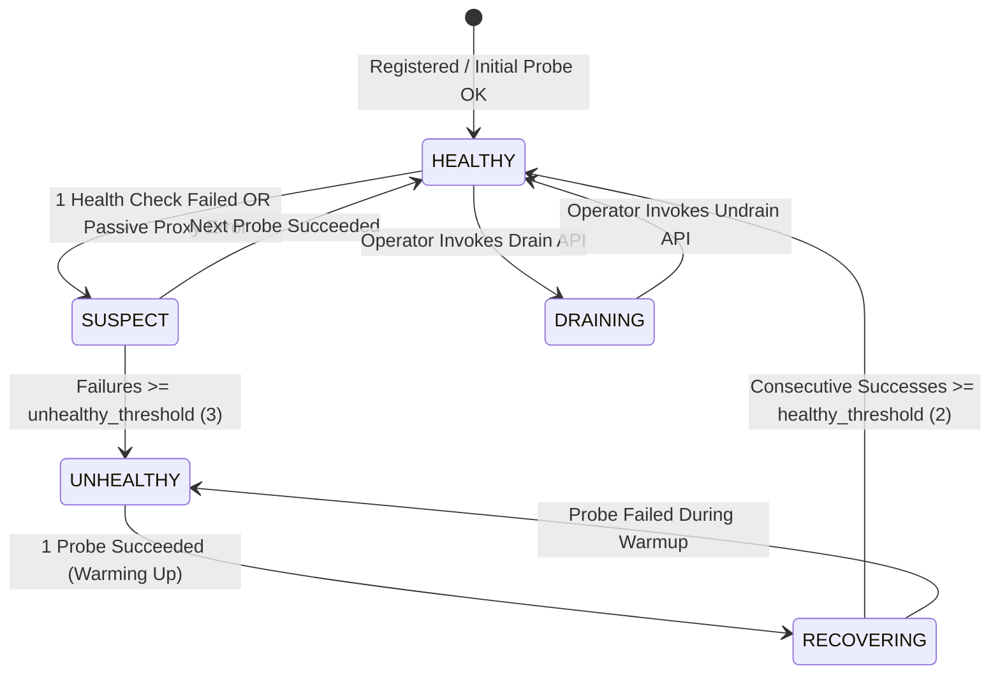
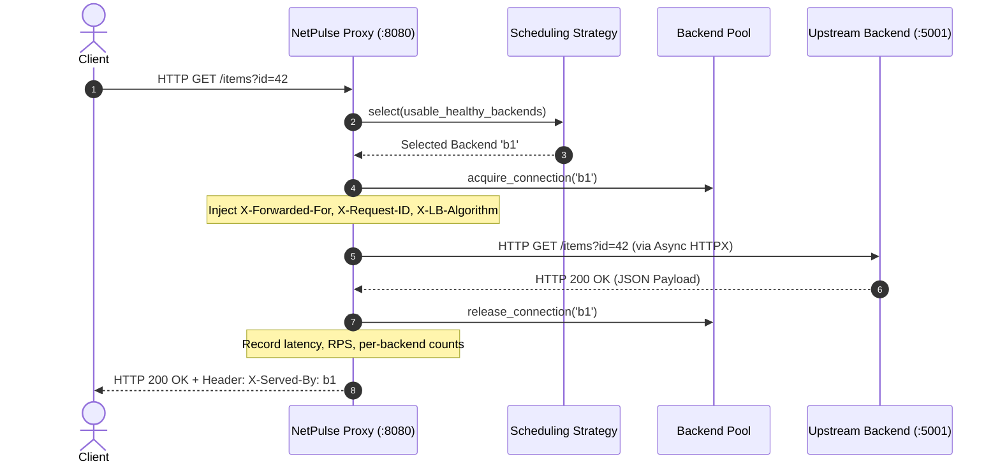

# NetPulse: Comprehensive Team Technical Ownership & Viva Preparation Guide

**System Name**: NetPulse: Intelligent Network Traffic Management, Adaptive Load Balancing & Fault-Tolerant Monitoring System  
**Course**: Computer Networks (CN) Laboratory & Project Evaluation  
**Target Environment**: Python 3.10+, FastAPI, Uvicorn, HTTPX, Chart.js, Pytest, Matplotlib, Wireshark  

---

## 1. Team of Four: Technical Module Ownership

| Role & Member | Module Ownership | Core Files Owned | Live Viva Demonstration Responsibility |
| :--- | :--- | :--- | :--- |
| **MEMBER 1**<br>Load Balancing Engine | • L7 Reverse Proxy Engine<br>• 4 Scheduling Algorithms<br>• Retry & Timeout Policy<br>• Hop-by-hop & Forwarding Headers | `loadbalancer/proxy.py`<br>`loadbalancer/algorithms/*`<br>`tests/test_algorithms.py` | • Explain mathematical Smooth WRR & Least Connections.<br>• Demonstrate dynamic algorithm switching live.<br>• Walk through request header injection in code. |
| **MEMBER 2**<br>Health Monitoring & Fault Tolerance | • Asynchronous Health Monitor<br>• State Machine Transitions<br>• Active Probes & Passive Failure Signals<br>• Graceful Draining & Recovery Warmup | `loadbalancer/health.py`<br>`loadbalancer/pool.py`<br>`tests/test_health.py`<br>`tests/test_failover.py` | • Demonstrate backend death live (`tools/failure_test.py`).<br>• Show state transition: `HEALTHY` $\to$ `SUSPECT` $\to$ `UNHEALTHY`.<br>• Prove zero-downtime failover and recovery. |
| **MEMBER 3**<br>Demo Store & Observatory Dashboard | • NetPulse Demo Store Web App (`:8080/app`)<br>• Product Catalogue & Persistent Orders API<br>• Real-Time Network Activity Telemetry Drawer<br>• Observatory Dashboard UI & Chart.js Integration<br>• Dynamic Backend Fleet CRUD & CORS Security | `app/index.html`<br>`app/assets/*`<br>`backend/products.py`<br>`backend/orders.py`<br>`dashboard/index.html`<br>`loadbalancer/admin.py`<br>`tests/test_demo_store.py` | • Demonstrate browsing, search, and checkout at `:8080/app`.<br>• Show Network Activity drawer (`X-Served-By`, `X-LB-Latency-Ms`).<br>• Walk through Observatory UI at `:8080/dashboard`.<br>• Explain CORS origins and non-idempotent POST order safety. |
| **MEMBER 4**<br>Metrics, Performance & Network Analysis | • High-Throughput Async Metrics<br>• Automated Algorithm Benchmark Suite<br>• Matplotlib Graph & CSV Generation<br>• L4 TCP Proxy & Wireshark Packet Analysis | `loadbalancer/metrics.py`<br>`tools/compare_algorithms.py`<br>`tools/load_gen.py`<br>`loadbalancer/tcp_proxy.py`<br>`docs/wireshark_guide.md` | • Run `tools/compare_algorithms.py` and explain graphs.<br>• Explain P50, P95, P99 latency percentiles.<br>• Inspect packet capture in Wireshark (TCP handshakes & resets). |

---

## 2. System Architecture & Diagrams

### 2.1. Complete System Architecture
```mermaid
graph TD
    Client["Client Browser / Load Generator"] -->|HTTP Requests on Port 8080| Proxy["NetPulse L7 Reverse Proxy (FastAPI/Uvicorn)"]
    Client -->|Web Dashboard on Port 8080/dashboard| Proxy
    Client -.->|Raw TCP Stream on Port 8081| L4Proxy["NetPulse L4 TCP Stream Proxy"]

    subgraph "Core Load Balancer Engine"
        Proxy --> Strategy["Algorithm Selector<br>(RR / Smooth WRR / LeastConn / IPHash)"]
        Proxy --> Metrics["Metrics Collector<br>(Bounded Sliding Window, P95, RPS)"]
        Strategy --> Pool["Backend Registry Pool"]
        Health["Asynchronous Health Monitor"] -->|Active GET /health Probes (every 2s)| Pool
        Proxy -.->|Passive Failure Signal| Health
    end

    subgraph "Admin & Observability"
        Admin["Admin REST API (Port 9090)"] --> Pool
        Admin --> Metrics
        Admin --> Health
        Admin --> Strategy
    end

    Pool -->|Forwarded HTTP Request| B1["Backend b1 (Port 5001, Weight 5)"]
    Pool -->|Forwarded HTTP Request| B2["Backend b2 (Port 5002, Weight 3)"]
    Pool -->|Forwarded HTTP Request| B3["Backend b3 (Port 5003, Weight 1)"]
    L4Proxy -.->|Raw TCP| B1
```

### 2.2. Health Monitor Finite State Machine (FSM)


### 2.3. Reverse Proxy Request Forwarding Flow


---

## 3. Five-Minute Live Demonstration Script for Examiners

### Minute 1: Starting the Fleet & Architecture Overview
* **Action**: Open 3 PowerShell terminals:
  ```powershell
  # Terminal 1: Launch all 3 demo backend servers
  python tools/failure_sim.py demo

  # Terminal 2: Launch NetPulse Load Balancer & Admin API
  python -m loadbalancer.main
  ```
* **Speaker (Member 1)**:  
  *"NetPulse is an asynchronous Layer-7 HTTP reverse proxy and traffic management system written in Python using FastAPI, Uvicorn, and HTTPX. On startup, it initializes an upstream pool of three backends with weights 5, 3, and 1, starts active background health checking every 2 seconds, and binds the proxy to port 8080 and the admin observability API to port 9090."*

### Minute 2: NetPulse Demo Store & Observatory Dashboard
* **Action**:
  1. Open browser at `http://127.0.0.1:8080/app` (NetPulse Demo Store).
  2. Search for *"10G"*, view technical specs for *PulseRoute Pro 10G*, add to cart, and click **"Proceed to Simulated Checkout"**.
  3. Submit order: submit generates a real `POST /api/orders` payload through the reverse proxy.
  4. Open the **"Live Network Activity"** drawer: show the examiner the actual serving backend (`X-Served-By: b1`), latency, and request ID.
  5. Switch to `http://127.0.0.1:8080/dashboard`: show how all client requests from the Demo Store updated the backend distribution and latency graphs in real-time.
  6. Switch scheduling algorithm to **Smooth Weighted Round Robin** using the quick pill.
* **Speaker (Member 3)**:  
  *"To prove our system handles real-world web application traffic, we built the NetPulse Demo Store. Notice that the frontend never calls backend ports directly; every search, catalog fetch, and checkout request enters the reverse proxy on port 8080. The proxy inspects the active scheduling algorithm, dispatches the request to an available backend node, measures upstream latency, and attaches RFC-compliant diagnostic headers (`X-Served-By`, `X-LB-Latency-Ms`). On the Observatory Dashboard, all metrics—RPS, latency percentiles, error rate, and backend distributions—are fed live from the Admin API without any hardcoded numbers. We can change the scheduling strategy to Smooth Weighted Round Robin with zero downtime, and our requests immediately follow the new 5:3:1 distribution."*

### Minute 3: Fault Injection & Automatic Failover
* **Action**: In the dashboard, click **"Fail"** on backend `b2` (or terminate port 5002 in terminal).
* **Speaker (Member 2)**:  
  *"Now we simulate a node failure. Watch the health card for backend b2 transition immediately from HEALTHY to SUSPECT and then UNHEALTHY as the background monitor detects consecutive probe failures. Notice the health event timeline record the transition. If we fire 20 more requests through the load balancer, 100% of the traffic is instantly rerouted to b1 and b3 with zero 502/504 errors dropped to the client."*

### Minute 4: Verified Recovery & Draining
* **Action**: In the dashboard, click **"Restore"** on backend `b2`.
* **Speaker (Member 2)**:  
  *"When the server returns, NetPulse does not blindly assume it can take full load. It probes `/health` until `healthy_threshold` consecutive successes are confirmed, records a `BACKEND_RECOVERED` event, and smoothly brings it back into rotation. Furthermore, we support zero-downtime maintenance using the Drain function, which prevents new traffic from being scheduled while allowing in-flight requests to complete."*

### Minute 5: Benchmarks, Latency Percentiles & Wireshark Packet Capture
* **Action**: In Terminal 3, run the automated comparison suite:
  ```powershell
  python tools/compare_algorithms.py --requests 60 --concurrency 6
  ```
* **Speaker (Member 4)**:  
  *"We built a benchmarking harness that runs identical concurrent workloads across Round Robin, Smooth Weighted Round Robin, and Least Connections, exporting results to CSV and generating 4-panel publication-grade comparison plots. Furthermore, using Wireshark on the loopback adapter, we can observe the separation between the client-to-proxy TCP handshake on port 8080 and the proxy-to-backend TCP connection on port 5001, verifying RFC-compliant hop-by-hop header stripping and `X-Forwarded-For` injection."*

---

## 4. 30 Technical Viva Questions & Answers

### Fundamentals & Architecture
#### Q1: What is the fundamental difference between a Forward Proxy and a Reverse Proxy?
**Answer**: A Forward Proxy sits in front of clients (e.g. within an enterprise LAN) and mediates their outbound requests to the external internet, typically for caching, content filtering, or client anonymity. A Reverse Proxy sits in front of private backend servers and intercepts inbound client requests from the internet, distributing them across servers, terminating TLS, enforcing load balancing, and shielding internal topology.

#### Q2: What is the difference between Layer-4 (L4) and Layer-7 (L7) Load Balancing?
**Answer**: Layer-4 load balancers operate at the Transport Layer (TCP/UDP), routing packets based solely on IP addresses and port numbers without inspecting application payload. Layer-7 load balancers operate at the Application Layer (HTTP/HTTPS), parsing the HTTP request line, headers, cookies, and URI paths. L7 enables content-based routing, header rewriting, and path forwarding, but incurs higher CPU overhead. In NetPulse, we implemented both: our core HTTP proxy is L7, and we built `loadbalancer/tcp_proxy.py` as an L4 stream proxy extension.

#### Q3: Why is Python `asyncio` well suited for a reverse proxy compared to multi-threading?
**Answer**: Network proxies are predominantly I/O-bound. With traditional multi-threading, each concurrent connection requires an OS-level thread with significant memory overhead (stack allocation) and kernel context-switching penalties. With `asyncio`, thousands of concurrent connections are multiplexed over a single OS thread via non-blocking sockets and OS event notification mechanisms (such as `epoll` on Linux or `IOCP` on Windows), resulting in minimal memory footprint and high connection density.

#### Q4: What are hop-by-hop headers according to RFC 7230 / RFC 9110, and why must a proxy strip them?
**Answer**: Hop-by-hop headers are meaningful only for a single transport-level connection and must not be forwarded across multiple hops by proxies. Examples include `Connection`, `Keep-Alive`, `Proxy-Authenticate`, `Proxy-Authorization`, `TE`, `Trailers`, `Transfer-Encoding`, and `Upgrade`. End-to-end headers (like `User-Agent`, `Accept`), conversely, must be preserved. NetPulse explicitly filters all RFC hop-by-hop headers in `ProxyEngine._build_headers()`.

#### Q5: What headers does NetPulse inject into forwarded requests, and why?
**Answer**: 
1. `X-Forwarded-For`: Appends the client's original IP address so upstream backends know the true client identity.
2. `X-Forwarded-Proto`: Informs the backend whether the initial request arrived via HTTP or HTTPS.
3. `X-Forwarded-Host`: Preserves the original `Host` header sent by the client.
4. `X-Request-ID`: A unique UUID injected to enable distributed request tracing across proxy and backend logs.
5. `X-Served-By` and `X-LB-Latency-Ms`: Diagnostic response headers returned to the client indicating which backend processed the request and proxy turnaround time.

---

### Algorithms & Scheduling
#### Q6: How does Round Robin differ from Weighted Round Robin?
**Answer**: Standard Round Robin treats all backends as having equal processing capacity, assigning requests in a simple circular sequence ($1 \to 2 \to 3 \to 1$). Weighted Round Robin assigns each backend a weight reflecting its hardware capacity (CPU/RAM). For weights 5, 3, and 1, the high-capacity server receives 5 requests for every 1 request assigned to the lowest server.

#### Q7: What problem does Nginx-style "Smooth" Weighted Round Robin solve over classical WRR?
**Answer**: Classical WRR often generates bursty schedules, sending 5 consecutive requests to `b1`, then 3 to `b2`, then 1 to `b3` ($b_1, b_1, b_1, b_1, b_1, b_2, b_2, b_2, b_3$). This can temporarily overload `b1`. Smooth WRR interleaves requests uniformly ($b_1, b_2, b_1, b_1, b_2, b_1, b_3, b_2, b_1$) by maintaining a running dynamic weight: on each selection, each server's current weight increases by its configured weight, the highest is picked, and the total weight is subtracted from the selected server.

#### Q8: How does the Least Connections algorithm work when servers have different weights?
**Answer**: In standard Least Connections, the server with the lowest `active_connections` is selected. In weighted Least Connections, load is normalized by configured weight:
$$\text{Effective Load} = \frac{\text{active\_connections}}{\text{effective\_weight}}$$
This ensures a server with weight 10 handling 2 connections is considered less loaded than a server with weight 1 handling 1 connection.

#### Q9: What is IP Hash load balancing, and what is its primary use case?
**Answer**: IP Hash computes a hash of the client's IP address (`hash(client_ip) % num_backends`) to deterministically map that client to the same backend. It provides session stickiness (session affinity) for stateful applications without requiring external distributed session caches.

#### Q10: How does NetPulse ensure zero-weight or drained backends receive zero traffic?
**Answer**: Each `Backend` object computes an `effective_weight` property. If `backend.draining` is `True` or `backend.state != "HEALTHY"`, `effective_weight` evaluates to `0`. All selection algorithms filter for backends where `effective_weight > 0`, completely preventing traffic dispatch.

---

### Fault Tolerance & Health Monitoring
#### Q11: What is the difference between Active and Passive Health Checking?
**Answer**: Active health checking periodically generates synthetic probe requests (e.g. `GET /health` every 2s) to each backend. Passive health checking observes real client traffic; if an upstream request times out or returns a connection refused during normal proxy forwarding, it records a passive failure signal. NetPulse implements both: background active probes via `HealthMonitor.run()` and passive failure signals via `ProxyEngine.forward()`.

#### Q12: Why is the `SUSPECT` state necessary instead of immediately marking a server `UNHEALTHY`?
**Answer**: Transient network blips or momentary garbage collection pauses can cause a single probe to fail. If a load balancer immediately marked a server dead on 1 failure, it could trigger cascade failover and flapping. The `SUSPECT` state acts as a buffer: only after `unhealthy_threshold` (e.g. 3) consecutive failures is the server marked `UNHEALTHY`.

#### Q13: What is "Graceful Draining" and how is it implemented?
**Answer**: Draining allows an administrator to pull a server out of service for upgrades without disrupting active users. When a backend is drained, its `effective_weight` drops to 0 so no *new* requests are routed to it, while existing in-flight connections tracked by `active_connections` are allowed to complete.

#### Q14: What is the slow-start / recovery policy when an unhealthy server restarts?
**Answer**: When a server restarts, its caches are cold and JIT compilation may be unprimed. NetPulse requires the server to pass `healthy_threshold` (e.g. 2) consecutive successful probes before transitioning to `HEALTHY`, preventing flapping if a process restarts and crashes repeatedly.

#### Q15: What HTTP status code should a load balancer return when all backends are down, vs when an upstream times out?
**Answer**:
- **503 Service Unavailable**: When the proxy has zero eligible/healthy backends in its pool.
- **504 Gateway Timeout**: When the proxy selected a backend, but the upstream server failed to respond within the configured `request_timeout_s`.
- **502 Bad Gateway**: When the proxy attempts a TCP connection to the upstream server and receives a TCP RST (connection refused) or remote protocol error.

---

### Networking & HTTP Protocols
#### Q16: Walk through the TCP packet exchange that occurs during a client request through NetPulse.
**Answer**:
1. Client $\to$ Proxy (:8080): `[SYN]`, Proxy $\to$ Client: `[SYN, ACK]`, Client $\to$ Proxy: `[ACK]` (Client 3-way handshake).
2. Client $\to$ Proxy: `GET /test HTTP/1.1`.
3. Proxy $\to$ Backend (:5001): `[SYN]`, Backend $\to$ Proxy: `[SYN, ACK]`, Proxy $\to$ Backend: `[ACK]` (Upstream 3-way handshake or reused keepalive socket).
4. Proxy $\to$ Backend: Injected HTTP request with `X-Forwarded-For`.
5. Backend $\to$ Proxy: `HTTP/1.1 200 OK`.
6. Proxy $\to$ Client: `HTTP/1.1 200 OK` with `X-Served-By: b1`.

#### Q17: What is TCP Connection Keep-Alive and connection pooling?
**Answer**: Establishing a TCP connection requires a 3-way handshake, adding 1 round-trip time (RTT) of latency. HTTP Keep-Alive allows the same TCP connection to be reused for multiple sequential HTTP requests. NetPulse uses an `httpx.AsyncClient` with connection pooling (`max_keepalive_connections=50`), amortizing handshake overhead across requests.

#### Q18: What is CORS, and why did our dashboard encounter a CORS error during initial development?
**Answer**: Cross-Origin Resource Sharing (CORS) is a browser security mechanism that restricts web pages from making HTTP requests to a different domain, protocol, or port than the one that served the page. Our dashboard was served from `http://127.0.0.1:8080/dashboard`, but called the Admin API on `http://127.0.0.1:9090`. Because the ports differed, the browser issued CORS preflight `OPTIONS` requests. We resolved this by adding `CORSMiddleware` restricted to local development origins (`http://127.0.0.1:8080`, `http://localhost:8080`, `http://127.0.0.1:9090`, `http://localhost:9090`).

#### Q19: What is an HTTP preflight request?
**Answer**: For cross-origin requests that use methods other than simple GET/POST, or include custom headers, the browser automatically transmits an `OPTIONS` request containing `Origin` and `Access-Control-Request-Method` headers. The server must respond with `Access-Control-Allow-Origin` and `Access-Control-Allow-Methods` before the actual request is sent.

#### Q20: What is the difference between safe and idempotent HTTP methods, and how does NetPulse handle retries?
**Answer**: A safe method does not modify server state (`GET`, `HEAD`). An idempotent method produces the same server state regardless of whether it is executed once or multiple times (`PUT`, `DELETE`). Non-idempotent methods (`POST`, `PATCH`) may create duplicate records if retried. NetPulse limits automated retries exclusively to `RETRYABLE_METHODS = {"GET", "HEAD", "PUT", "DELETE", "OPTIONS"}`.

---

### Performance, Metrics & Testing
#### Q21: Why are Average Latencies misleading in network performance evaluation, and why do we measure P95 and P99?
**Answer**: Latency distributions are heavily right-skewed with long tails caused by garbage collection, context switching, and network packet queuing. An average conceals severe latency spikes experienced by users. P95 (95th percentile) means 95% of requests completed faster than that threshold, exposing tail latency that impacts customer experience.

#### Q22: How does NetPulse ensure metrics memory remains bounded during long benchmarks?
**Answer**: Retaining an unbounded list of request latencies in memory (`latencies.append()`) causes a progressive memory leak under heavy load. NetPulse utilizes `collections.deque(maxlen=10000)`, enforcing a fixed-size circular sliding window that caps memory consumption at $O(1)$ space.

#### Q23: How do we prevent double-counting client requests when upstream retries occur?
**Answer**: In `ProxyEngine`, each client request invokes `metrics.record_client_request()` exactly once upon final completion or failure. If the proxy tries an upstream backend that fails and subsequently retries an alternate backend, each attempt invokes `metrics.record_backend_attempt()` and increments `total_retries`, ensuring `total_requests` matches actual ingress volume.

#### Q24: What is the purpose of concurrency semaphores in our load testing tool?
**Answer**: In `tools/load_gen.py` and `tools/compare_algorithms.py`, launching 1,000 unbounded asynchronous tasks simultaneously would exhaust local OS socket descriptors. We enforce `asyncio.Semaphore(concurrency)` to simulate a fixed pool of concurrent client connections.

#### Q25: How do we test load balancer failover automatically in `pytest` without real backends?
**Answer**: In `tests/test_health.py` and `tests/test_proxy_errors.py`, we use `pytest`'s `monkeypatch` fixture to mock `httpx.AsyncClient`. This simulates connection errors, timeouts, and HTTP status codes deterministically and instantaneously without running external server processes or relying on network timing.

---

### Advanced Scenarios & Limitations
#### Q26: What is a Thundering Herd problem, and how can health checks cause it?
**Answer**: If all health checks run synchronously at the exact same interval, all backends receive probe traffic simultaneously, causing periodic CPU spikes. To mitigate this in large deployments, randomized jitter (e.g. $\pm 10\%$) is added to probe intervals.

#### Q27: How does NetPulse avoid race conditions when concurrent requests select backends?
**Answer**: Each `Backend` object protects its `active_connections` counter with an `asyncio.Lock()`. The lock is acquired during selection and released upon request completion within a `finally` block, ensuring atomic connection tracking.

#### Q28: How would you scale NetPulse itself if the load balancer becomes the CPU bottleneck?
**Answer**: A single reverse proxy instance can saturate a single core's CPU. To scale NetPulse:
1. Run multiple Uvicorn worker processes with `uvicorn --workers 4`.
2. Use DNS Round Robin or Layer-4 BGP ECMP (Equal-Cost Multi-Path) routing with Linux IPVS / Maglev to distribute traffic across multiple NetPulse proxy instances.

#### Q29: What are the primary technical trade-offs made in NetPulse?
**Answer**:
1. **In-Memory State**: Backends and metrics are maintained in memory. A proxy restart clears history (satisfies lab requirements without database overhead).
2. **Layer 7 Parsing**: Full HTTP parsing incurs higher memory and CPU overhead than raw kernel-space eBPF or L4 stream proxying.
3. **Single Load Balancer Instance**: While backends are fault-tolerant, the load balancer is a single point of failure without VRRP/Keepalived or DNS failover.

#### Q30: What future improvements could be added to NetPulse?
**Answer**:
1. TLS/SSL termination with Let's Encrypt automated certificate renewal.
2. Dynamic configuration reloading via Consul or etcd service discovery.
3. Redis-backed shared distributed session store for sticky sessions.
4. HTTP/2 and HTTP/3 (QUIC) multiplexing support.

#### Q31: How does the NetPulse Demo Store integrate with the Load Balancer without bypassing the reverse proxy?
**Answer**: The Demo Store frontend is served from `/app` on port 8080. When client JavaScript initiates API requests (`GET /api/products`, `POST /api/orders`), the destination origin is always `http://127.0.0.1:8080`. The load balancer intercepts all requests matching `/{path:path}`, executes scheduling logic across the healthy pool (`b1`, `b2`, `b3`), forwards the request to the chosen backend port (5001, 5002, or 5003), and returns the backend response back through the proxy to the browser. The browser never opens a direct socket to backend ports.

#### Q32: Why are order creation requests (`POST /api/orders`) marked non-idempotent and excluded from automatic proxy retries?
**Answer**: In HTTP and distributed systems, `GET`, `HEAD`, and `PUT` are idempotent operations (repeating them has no additional state change). `POST` requests create new state (such as placing a new order or charging a card). If an upstream server experiences a read timeout after writing the order to storage, automatically retrying the `POST` request would cause duplicate order creation. NetPulse restricts automatic retries exclusively to safe, idempotent methods defined in `RETRYABLE_METHODS = {"GET", "HEAD", "OPTIONS"}`.

#### Q33: How does NetPulse guarantee product catalogue consistency across independent backend nodes?
**Answer**: Instead of maintaining independent or conflicting databases on each backend server, NetPulse employs a shared immutable catalogue model (`backend/products.py`). Every backend node references the identical product definitions, specs, and category structures. Furthermore, simulated customer orders are persisted with thread-safe file locks into a shared storage ledger (`results/orders.json`), preventing state skew regardless of which node processed the request.

#### Q34: How does the frontend extract and display `X-Served-By` and `X-LB-Latency-Ms` headers?
**Answer**: In `app/assets/app.js`, our API client wrapper intercepts every standard `fetch()` call. When the response arrives, the wrapper queries `response.headers.get("X-Served-By")`, `response.headers.get("X-LB-Latency-Ms")`, and `response.headers.get("X-Request-ID")`. To allow the browser JavaScript access to custom headers across domains or ports, the Load Balancer explicitly configures `expose_headers=["*"]` in its FastAPI `CORSMiddleware`. The captured metadata immediately updates the navbar status badge and streams to the Live Network Activity drawer.

#### Q35: How does the system behave if an active backend fails during a customer's shopping session?
**Answer**: If backend `b2` crashes while a customer is browsing products:
1. The next request to `b2` triggers a `ConnectError` or timeout in the reverse proxy.
2. Because `GET /api/products` is idempotent, the proxy immediately retries the request against an alternative healthy backend (`b1` or `b3`).
3. The customer receives a seamless 200 OK response with zero dropped requests.
4. Concurrently, the proxy's passive failure signaler alerts `HealthMonitor.record_passive_failure()`, accelerating the transition of `b2` to `SUSPECT` and `UNHEALTHY` so that subsequent traffic avoids `b2` entirely.

---

## 5. Team Contribution Report Template

> **Note for Evaluators**: Fill in student names, roll numbers, and confirmed contributions below. All code modules are modularized with clear technical boundaries.

### Student 1: Load Balancing Engine Specialist
- **Student Name**: `[Enter Student 1 Full Name]`
- **Roll / Registration No**: `[Enter Roll Number]`
- **Assigned Module**: Reverse Proxy Core & Scheduling Algorithms
- **Core Deliverables**:
  - Implemented reverse proxy request forwarding, hop-by-hop header stripping (RFC 7230/9110), and header injection (`X-Forwarded-*`, `X-Request-ID`).
  - Designed and implemented 4 scheduling strategies: Round Robin, Smooth Weighted Round Robin, Least Connections, and IP Hash.
  - Built deterministic algorithm test suite (`tests/test_algorithms.py`).
- **Viva Demonstration**: Runtime algorithm switching without restart, dynamic weight distribution, and reverse proxy request inspection.

### Student 2: Fault Tolerance & High Availability Specialist
- **Student Name**: `[Enter Student 2 Full Name]`
- **Roll / Registration No**: `[Enter Roll Number]`
- **Assigned Module**: Health Monitoring & Automatic Failover
- **Core Deliverables**:
  - Implemented asynchronous active health checking (`GET /health` probes) and passive failure detection from reverse proxy forward errors.
  - Built 5-state finite state machine (`HEALTHY`, `SUSPECT`, `UNHEALTHY`, `RECOVERING`, `DRAINING`) with threshold dampening.
  - Implemented graceful connection draining and automatic failover tests (`tests/test_failover.py`, `tests/test_health.py`).
- **Viva Demonstration**: Killing a backend live, observing real-time transition to `SUSPECT` $\to$ `UNHEALTHY`, and proving zero-downtime failover and recovery.

### Student 3: Demo Store & Frontend Observability Engineer
- **Student Name**: `[Enter Student 3 Full Name]`
- **Roll / Registration No**: `[Enter Roll Number]`
- **Assigned Module**: NetPulse Demo Store E-Commerce Web App & Observatory Dashboard UI
- **Core Deliverables**:
  - Developed user-facing NetPulse Demo Store (`app/index.html`, `app/assets/*`) with responsive product catalogue, live search, categories, and shopping cart.
  - Implemented shared immutable product catalogue (`backend/products.py`) and thread-safe persistent order processing (`backend/orders.py`).
  - Built Real-Time Network Activity Telemetry drawer capturing proxy response headers (`X-Served-By`, `X-LB-Latency-Ms`, `X-Request-ID`).
  - Authored comprehensive automated test suite (`tests/test_demo_store.py`) verifying catalogue, filtering, order validation, and `/app` routing.
  - Built dark navy observatory console (`dashboard/index.html`) using modern CSS, JavaScript, and Chart.js.
  - Developed Admin REST API (`loadbalancer/admin.py`) and configured strict CORS permissions between `:8080` and `:9090`.
- **Viva Demonstration**: Live Demo Store walkthrough at `:8080/app`, placing a simulated order, verifying `X-Served-By` in the telemetry drawer, and observing live chart updates on `:8080/dashboard`.

### Student 4: Performance, Metrics & Network Analysis Engineer
- **Student Name**: `[Enter Student 4 Full Name]`
- **Roll / Registration No**: `[Enter Roll Number]`
- **Assigned Module**: Metrics Engine, Benchmarking & Network Packet Analysis
- **Core Deliverables**:
  - Built concurrent performance metrics engine (`loadbalancer/metrics.py`) with bounded memory sliding window deque (`maxlen=10000`).
  - Created automated reproducible benchmark harness (`tools/compare_algorithms.py`) exporting CSV and 4-panel Matplotlib comparison figures.
  - Authored Wireshark packet capture guide (`docs/wireshark_guide.md`) and L4 TCP stream proxy extension (`loadbalancer/tcp_proxy.py`).
- **Viva Demonstration**: Running live comparative benchmark, analyzing throughput vs P95/P99 latency curves, and demonstrating Wireshark packet capture analysis.

